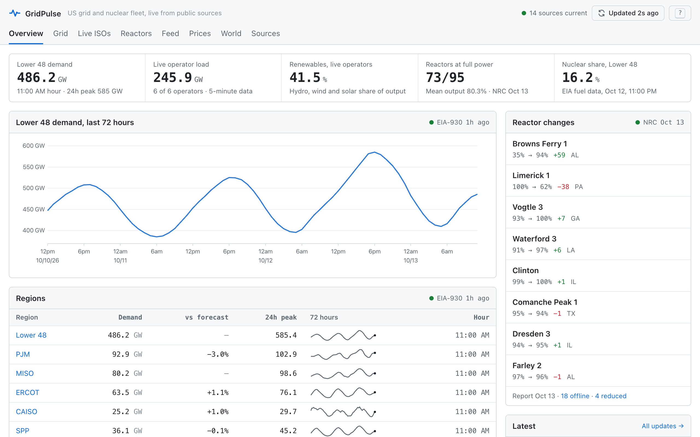
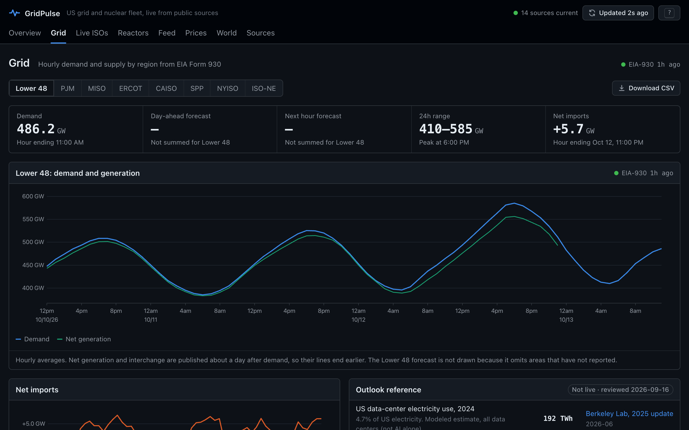
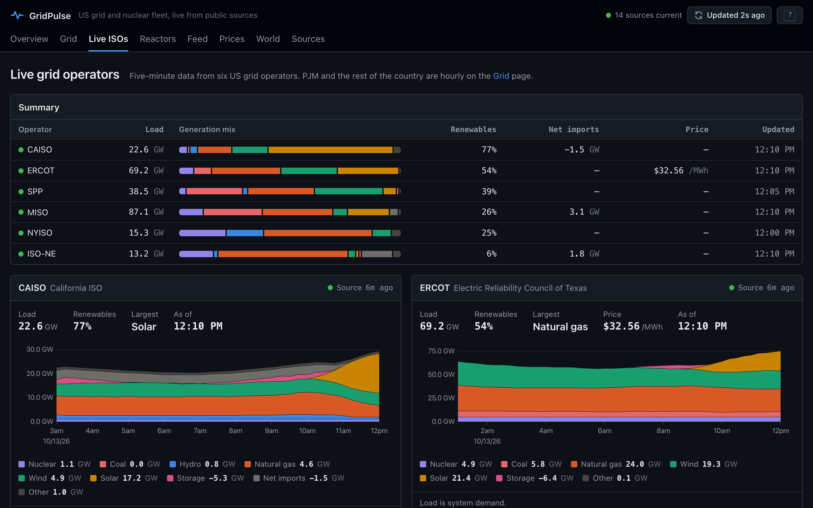
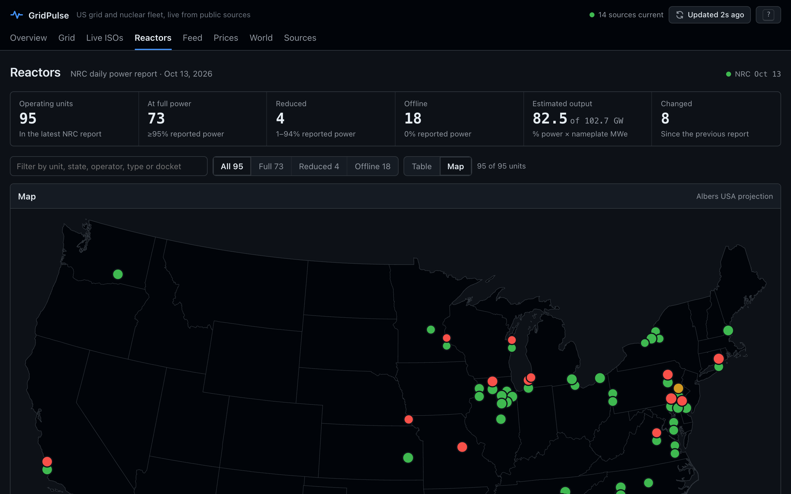

# GridPulse

A live console for the US electricity grid and nuclear fleet, built only on free public data. No accounts, no database, no paid services.

**[Open the live console →](https://gridpulse000.vercel.app)**

<picture>
  <source media="(prefers-color-scheme: dark)" srcset="docs/screenshots/overview-dark.png">
  
</picture>

## What it shows

| Page | What it shows | Source | Updates |
|---|---|---|---|
| Overview | Demand, live operator load, reactor changes, latest news | All of the below | — |
| Grid | Hourly demand, day-ahead forecast, net generation and net imports for Lower 48 and seven ISOs; US48 generation by fuel | EIA-930 | Hourly, ~1 h behind (fuel mix ~1 day behind) |
| Live ISOs | Load and generation mix for CAISO, ERCOT, SPP, MISO, NYISO, ISO-NE; ERCOT hub price | Operator dashboards | 5 minutes |
| Reactors | Every operating US unit: power today, change, 365-day history, map | NRC daily power reactor status | Each business day |
| Feed | News and notices, including NRC event reports | WNN, NRC, DOE NE, EIA, PJM, ISO-NE feeds | As published |
| Prices | Retail price by state and sector with year-over-year change | EIA retail sales | Monthly, ~3 months behind |
| World | Nuclear fleet by country | World Nuclear Association | Monthly |
| Sources | Status of every source, computed in the browser | — | — |

Every number carries the time its source observed it. Filters live in the URL, so any view can be shared. Keyboard: `g` then a letter switches pages (`g o`, `g r`, …), `/` focuses search, `r` refreshes, `?` lists shortcuts.

| Grid | Live ISOs | Reactors |
|---|---|---|
|  |  |  |

## How it stays up

- **Independent sources.** Each source in `api/sources/__init__.py` has its own refresh interval and staleness limit. A request waits only for the sources it needs, and at most 2.5 s when cached data exists.
- **Last good data wins.** A failed or implausible refresh never replaces data. Parsers validate shape and coverage and raise instead of guessing; the page shows the source as Retrying or Stale.
- **Fallbacks.** If EIA's API is rate-limited or down, the same series come from EIA's keyless Grid Monitor endpoints.
- **Cold starts.** `api/data/snapshot.json` seeds a new instance. Refresh it with `python3 scripts/refresh_snapshot.py`.
- **CDN.** Responses carry `stale-while-revalidate` and `stale-if-error`, so visitors are served from the edge and an origin error keeps the last response online.
- **Honest time.** Status is computed in the browser from source timestamps, so a cached response cannot show a frozen "current".

What each figure means, and where it can mislead, is in [docs/data.md](docs/data.md).

## Run locally

Requires Python 3.9+ and Node 18+.

```sh
python3 -m pip install -r api/requirements.txt uvicorn
python3 -m uvicorn api.index:app --reload --port 8000
```

In another terminal:

```sh
cd frontend && npm install && npm run dev    # http://localhost:5173
```

Set `EIA_API_KEY` ([free](https://www.eia.gov/opendata/register.php), see `.env.example`) for reliable EIA access. Without it the shared `DEMO_KEY` allows about 10 requests an hour, after which GridPulse switches to EIA's slower keyless endpoints.

## Deploy your own

Import the repository into [Vercel](https://vercel.com/new). `vercel.json` builds the frontend and deploys `api/index.py` as a Python function; no other settings are needed. Add `EIA_API_KEY` as an environment variable.

## Layout

```
api/index.py          routes and cache headers (Vercel function)
api/store.py          per-source cache with last-good fallback
api/sources/          one module per upstream; pure parsers + fetchers
api/data/             reactor reference data, cold-start snapshot
frontend/src/         React console (views/, components/, lib/)
tests/                Python unittest + node:test, offline fixtures
```

## Tests

```sh
python3 -B -m unittest discover -s tests
npm test --prefix frontend
npm run build --prefix frontend
```

Tests run offline against recorded fixtures. CI runs all three on every push.

## Data

The data belongs to its publishers: the US Energy Information Administration, the US Nuclear Regulatory Commission, CAISO, ERCOT, SPP, MISO, NYISO, ISO New England, the World Nuclear Association, and the news outlets in the feed, whose items link to the original articles. GridPulse is not affiliated with any of them, and its figures are not official.

## License

Code is [MIT](LICENSE).
